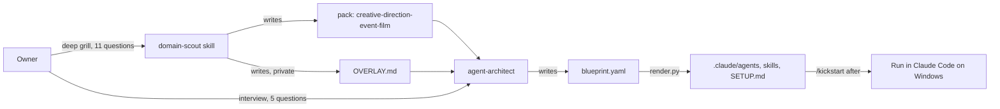
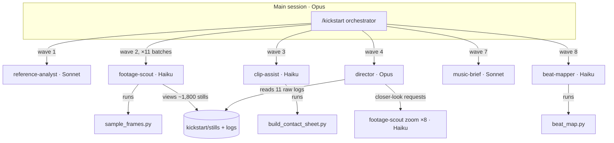
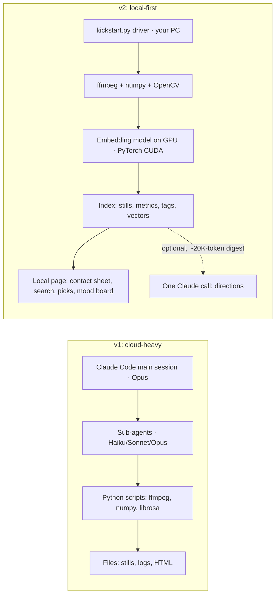
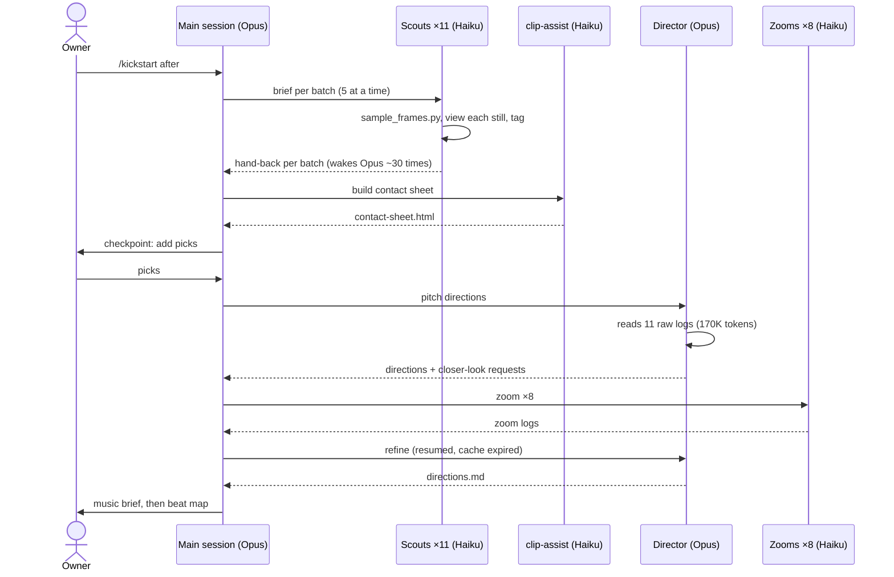
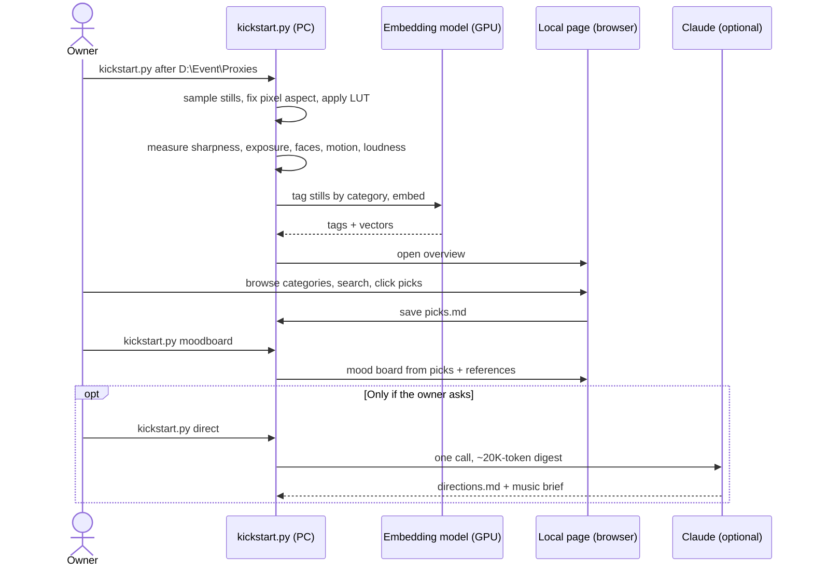

# Handoff: event kickstart, v1 → v2

Written 2026-11-22 for a new thread. Read it top to bottom before doing anything. Then
**grill the owner through section 7, one question at a time**, each with your recommended
answer, before writing code. Decisions go into a decision log (see step 1).

## Contents
1. What are we trying to make?
2. What was made?
3. How did it go?
4. What needs to be improved or worked on?
5. Technologies used, and for what
6. Tech stack: current and proposed
7. The proposed plan, step by step, with grill questions
8. Sequence: how a run flows, v1 and v2
9. Open questions and unverified facts
10. Where everything is

---

## 1. What are we trying to make?

**A local-first overview tool for a solo creative director.** The owner shoots and edits
event aftermovies and short commercials alone: one Panasonic GH5 II in V-Log L, about
300 clips and 300–500 GB per event, Premiere Pro today and probably DaVinci Resolve soon,
on a Windows PC with an RTX 5070 Ti (16 GB) and 64 GB of RAM.

The hardest step for him is **starting the edit**: facing hundreds of clips without a
sense of direction. What helps is an **overview**: every clip as a few good stills,
sorted into categories, searchable, with his own picks marked, and a **mood board** that
gathers picks, references and colours. Creative suggestions from a cloud model are an
optional extra, only after the overview is trusted.

The guiding rule, learned the hard way in v1: **scripts and local models do everything
they can; a cloud model is used only for judgement, with a small input.**

Out of scope for now (parked): upscaling exports, cleaning up sound, legal and rights.

Two supporting projects are improved along the way, using what this one teaches:
- **agent-architect**: an Agent Skill that interviews a user and generates multi-agent
  systems from a blueprint.
- **domain-scout**: domain packs (how a field works, its tools and questions) and a skill
  that writes them.

## 2. What was made?

| Thing | What it is | Where |
|---|---|---|
| agent-architect v0.2 work | Domain-pack loading (`references/domains.md`, `scripts/find_pack.py`); `system.requirements`; `run` waves (a script step with no agent); level 0 "no agent" and an engine-per-step table in the interview; cost rules; Windows fixes; eval write-up. | `keyanjavanshir/architect`, branch `claude/charming-faraday-lumq4e` |
| domain-scout v0.1 | New repo. The `domain-scout` skill (grills the user, quick or deep; researches; writes a pack), pack format, `validate_pack.py`, overlay format, tests, CI. | `keyanjavanshir/domain-scout`, same branch name (`main` is behind) |
| Pack `creative-direction-film` | General pack: client film and video work. Draft. | domain-scout `domains/` |
| Pack `creative-direction-event-film` | Narrow pack from the owner's deep grill: solo, aftermovies, short commercials. Draft. | domain-scout `domains/` |
| Overlay | The owner's private team details (client, camera, tools, priorities). Never committed. | Owner's project: `.agent-architect/domains/creative-direction-event-film/OVERLAY.md` |
| event-kickstart v1 | Generated system: `/kickstart` orchestrator, 6 agents, 4 skills, 3 scripts. | Blueprint copy: `docs/handoff/event-kickstart-v1/blueprint.yaml`; rendered files in the owner's project |

v1 in one picture:

## 3. How did it go?

**Design session (2026-11-20).** The pack and overlay worked: they answered about twelve
questions up front, so the interview needed five. It also surfaced ten findings, all fixed
(see `docs/evals/2026-11-20-event-film.md`, findings 1–10).

**The owner's real run (2026-11-21).** One event, full `/kickstart after`, Windows.

- **Cost: about $13** at API list prices (measured by the owner from transcripts).
  | Who | Model | Cost | Share |
  |---|---|---|---|
  | Main session (orchestrating) | Opus | $4.98 | 38% |
  | Director (pitch and refine) | Opus | $4.08 | 31% |
  | 11 scouts, ~1,800 stills viewed | Haiku | $3.47 | 26% |
  | 8 closer looks | Haiku | $0.35 | 3% |
  | Music brief, references, beat map, contact sheet | mixed | ~$0.24 | 2% |
- About 54M tokens processed; 91% were cache re-reads. The scout wave took ~25 minutes.
- **Why it was expensive:** the main session re-read 100–200K tokens on every turn, and
  about 30 turns were only "batch done, start the next". The director read all 11 raw logs
  (170K tokens) and was resumed after its cache expired. Scouts accumulated viewed images
  past 100K tokens, where Haiku costs 5× more.
- **Quality:** the creative directions were not useful. Two scout claims were false
  (sparklers, a medal), guessed from small stills; closer looks caught them.
- **What the owner valued:** stills with the LUT applied worked; the **contact sheet** was
  the best part ("I can get an overview quite easily").
- **The owner's reframe:** the need is less "produce something for me" and more "give me
  an overview and a starting point". Be extremely prudent about what needs a cloud agent.

## 4. What needs to be improved or worked on?

**Kickstart (the tool):**
- Stills look cropped or too small. The sampler only scales to 640 px; likely causes are
  non-square pixel aspect in the proxies (ignored) or simply size. Correct pixel aspect,
  keep larger stills for viewing.
- Contact sheet ignores nested folders and shows closer-look stills as duplicate clips.
- The frame-sampling skill's script path was wrong on the owner's setup.
- `beat_map.py` was half a beat off (123 vs 120 BPM); needs a `--bpm` override, or a
  downbeat-aware tracker.
- Wanted: a **categorized** overview, **text search** ("DJ with green lasers"), **picks by
  clicking**, a **mood board**.
- Architecture: move tagging, measuring and ranking to scripts and local models; one
  optional cloud call with a compact digest.

**agent-architect:**
- Use the new `run` waves for real in the v2 blueprint and check the rendered orchestrator
  in Claude Code.
- Known gap 1 still open: no end-to-end run of the bundled examples in any harness.
- Consider adding v2 as `examples/event-kickstart` once it works.

**domain-scout:**
- Update `creative-direction-event-film` with local-first tools and the anti-pattern "cloud
  agents viewing hundreds of stills"; review it with the owner; mark it reviewed.

**Housekeeping:** both repos' work is on `claude/charming-faraday-lumq4e`; domain-scout
`main` is behind; no pull request is open on architect.

## 5. Technologies used, and for what

| Technology | Used for | In v1 | In v2 |
|---|---|---|---|
| Python 3.11+ | All scripts; architect and domain-scout tooling | yes | yes |
| PyYAML | Blueprints, pack frontmatter | yes | yes |
| ffmpeg / ffprobe | Decoding proxies, picking frames, extracting stills, applying the LUT (`lut3d`), audio for loudness | yes | yes |
| numpy | Frame differences, sharpness, audio RMS in `sample_frames.py` | yes | yes |
| Panasonic V-Log → V-709 LUT (.cube) | Making V-Log L stills look normal | yes | yes |
| librosa | Tempo, beats, energy per bar (`beat_map.py`) | yes | maybe replaced |
| Static HTML + vanilla JS | Contact sheet (`build_contact_sheet.py`) | yes | grows into a local page |
| Claude Code | Running skills and sub-agents; `/kickstart` | yes | optional wrapper |
| Claude models (Opus, Sonnet, Haiku) | Orchestration, director, scouts, briefs | heavy | one optional call |
| agent-architect (`render.py`, `validate.py`, `find_pack.py`) | Generating and checking the system | yes | yes, with `run` waves |
| domain-scout (`validate_pack.py`) | Packs and overlays | yes | yes |
| MCP registry search | Finding tool servers (Epidemic Sound has one; Pixabay music has none) | design time | design time |
| Pixabay Music | Owner's current music source (search by hand) | yes | yes |
| Playwright + Chromium | Screenshot checks of generated pages (development only) | dev | dev |
| winget (Windows) | Installing Python and ffmpeg | yes | yes |
| **Proposed:** OpenCV | Faces, exposure and clipping, sharpness | — | yes |
| **Proposed:** an image-text embedding model (SigLIP or CLIP family) on PyTorch + CUDA | Category tags and text search per still, on the GPU, no tokens | — | yes |
| **Proposed, optional:** a local vision-language model via Ollama or LM Studio | Short free-text descriptions of top candidates | — | maybe |
| **Proposed, later:** a downbeat-aware beat tracker | Better beat maps | — | later |

Model names and versions for the proposed rows must be checked at build time (section 9).

## 6. Tech stack: current and proposed

## 7. The proposed plan, step by step

Each step lists what it delivers, the questions to grill the owner on (one at a time, with
the recommended answer first), and when it is done. Do not start a step before its
questions are settled.

### Step 0: Confirm the direction
- **Q: What is v2?** (1) A local overview tool, no tokens; (2) the same plus one optional
  Claude step on a compact digest; (3) the v1 agent system, slimmed. *Recommended: 1 now,
  2 once the overview is trusted.*
- **Q: What does success look like after one event?** *Recommended: you open the page, find
  your best 20 clips in under 15 minutes, and start cutting the same day.*
- Done when: the owner has answered both, and the answers are in the decision log.

### Step 1: Put the project under version control
- Deliver: a repository for the kickstart project with the v1 blueprint
  (`docs/handoff/event-kickstart-v1/blueprint.yaml`) as the starting point, a
  `decisions.md`, and a `.gitignore` for `proxies/`, `luts/`, `kickstart/`.
- **Q: A new private GitHub repo, or keep it local?** *Recommended: a private repo
  (e.g. `event-kickstart`) so threads can work on it; media never committed.*
- **Q: Keep it a blueprint-generated system, or a plain Python project?** *Recommended:
  plain Python package for the pipeline, plus a small blueprint whose `/kickstart` skill
  only calls it with `run` waves. Tests the architect's new feature without forcing the
  tool into agent shape.*
- Done when: the repo exists, the owner's project is cloned, the overlay stays local.

### Step 2: Fix the stills
- Deliver: correct pixel aspect (no squeeze or crop), two sizes per still (a large one for
  viewing, a small one for the model), nested folders, merged closer-look stills.
- **Q: How large should viewing stills be?** *Recommended: 1280 px wide, JPEG quality ~85.*
- **Q: Still at most 8 per clip?** *Recommended: yes, and up to 12 for clips over a minute.*
- **Q: Which clip shows the crop problem?** Ask for a file name to reproduce it.
- Done when: a still and the same frame in Premiere match edge to edge.

### Step 3: Measure every still
- Deliver: per still sharpness, exposure (mean, clipped highlights and shadows), face count
  and largest face size, motion; per clip loudness peaks.
- **Q: Which measurements should rank stills?** *Recommended: sharpness and exposure filter
  out bad frames; faces and energy (loudness + motion) rank the rest.*
- **Q: Hide technically bad stills, or only mark them?** *Recommended: mark and sort last;
  run-and-gun "bad" frames can still be the moment.*
- Done when: metrics for one event compute in minutes on the PC, written to an index file.

### Step 4: Tag and search on the GPU
- Deliver: each still scored against a fixed category list and the vision's shot wishlist;
  embeddings saved; text search over all stills.
- **Q: Which categories?** *Recommended start: stage and performers, crowd, close-up faces,
  people talking, details and decor, venue and establishing, food and drink, signage and
  branding, light effects, transitions and movement. The owner edits the list.*
- **Q: Is a ~3–5 GB model and PyTorch with CUDA on the PC acceptable?** *Recommended: yes;
  it is a one-time install and runs offline.*
- **Q: Add short free-text descriptions from a local vision-language model?** *Recommended:
  not yet; tags plus search first. Add descriptions only if tags miss too much.*
- Done when: tagging an event takes minutes, and 8 of 10 search queries the owner tries
  find what he remembered in the top results.

### Step 5: The overview page
- Deliver: a categorized contact sheet with filters (category, energy, faces, sharpness),
  text search, and picks by clicking, saved to `picks.md`.
- **Q: A static HTML file, or a small local web page served by the script?**
  *Recommended: served locally (`python kickstart.py view`, opens the browser). Text search
  needs the model at query time, and clicking picks needs somewhere to save them. Nothing
  leaves the PC.*
- **Q: Grouped by category first, or by time with category filters?** *Recommended: by
  category first (that is what the owner asked for), with a time view one click away.*
- Done when: the owner uses it on a real event and says it beats scrubbing in Premiere.

### Step 6: The mood board
- Deliver: a page built from picks and references (`references/` plus `notes.md`), with a
  colour palette extracted from the picks, and the owner's notes beside each reference.
- **Q: Is the mood board for you only, or also to show the client?** *Recommended: for you
  first; a clean export for the client later.*
- **Q: Free layout (drag to arrange) or an automatic grid?** *Recommended: automatic grid
  grouped by category, with drag to reorder; saved locally.*
- Done when: the owner would open it before cutting.

### Step 7: One command
- Deliver: `python kickstart.py after <proxies folder>` runs sample → measure → tag →
  index, then opens the page. `before` mode builds the mood board from references and the
  brief. A thin `/kickstart` skill (blueprint `run` waves) for use inside Claude Code.
- **Q: Run from a terminal or from Claude Code?** *Recommended: terminal for the
  pipeline; Claude Code only when the owner wants the optional creative step.*
- **Q: Pass the proxies folder as an argument?** *Recommended: yes; drop the fixed
  `proxies/` folder requirement.*
- Done when: one command on a fresh event produces the page, with zero tokens used.

### Step 8: The optional creative step
- Deliver: a digest (top ~60–80 stills as tags and metrics, picks, reference notes, brief;
  about 20K tokens, plus one montage image), sent to one fresh Claude call that returns two
  or three directions and a music brief.
- **Q: Add it now or after a few events with the overview?** *Recommended: after two
  events.*
- **Q: Which model and what budget?** *Recommended: Sonnet by default, Opus on request; a
  hard cap of $1 per run, logged.*
- Done when: a run costs under $1 and the owner rates the directions useful at least half
  the time.

### Step 9: Music and beats (later)
- Deliver: `--bpm` override in `beat_map.py`; evaluate a downbeat-aware tracker.
- **Q: Is the beat map worth keeping?** *Recommended: keep as a script, no agent; improve
  only if the owner uses it.*

### Step 10: Measure and feed back
- Deliver: per-run log of time, tokens and cost; an eval entry in architect
  `docs/evals/`; domain-scout pack updated (local-first tools, anti-patterns) and reviewed
  with the owner; architect example `examples/event-kickstart` if useful.
- **Q: What gets reported after each run?** *Recommended: time per stage, stills, tokens
  and cost, and one line from the owner on what helped.*

### Step 11: Housekeeping
- Merge or open pull requests for `claude/charming-faraday-lumq4e` in both repos;
  bring domain-scout `main` up to date. Ask before opening any pull request.

## 8. Sequence: how a run flows

**v1 (what ran):**

**v2 (proposed):**

## 9. Open questions and unverified facts

- The crop problem's cause (pixel aspect vs size) is not confirmed; get a sample.
- Which embedding model and version to use (SigLIP or CLIP family), its download size and
  speed on an RTX 5070 Ti: check current releases before choosing.
- Whether a local vision-language model (Qwen-VL family or newer) is worth it on 16 GB.
- Whether the frame-sampling path bug came from the working directory or the copied
  skills on Windows.
- Premiere ↔ Resolve OpenTimelineIO round trip: one user report of a `file://` prefix
  problem. Only matters if a timeline export is added.
- Whether the owner's GH5 II needs a paid key for V-Log L (the original GH5 did).

## 10. Where everything is

- agent-architect: `github.com/keyanjavanshir/architect`, branch
  `claude/charming-faraday-lumq4e`. Start with `CLAUDE.md`, then
  `docs/evals/2026-11-20-event-film.md`, `skills/agent-architect/references/interview.md`
  (level 0, engines) and `orchestration.md` (cost rules).
- domain-scout: `github.com/keyanjavanshir/domain-scout`, same branch. Start with
  `CLAUDE.md`; the pack is `domains/creative-direction-event-film/`.
- v1 blueprint (all prompts and the three scripts embedded):
  `docs/handoff/event-kickstart-v1/blueprint.yaml` in architect.
- The owner's overlay and rendered v1 files: in the owner's own project on Windows; ask
  for them, never commit the overlay.
